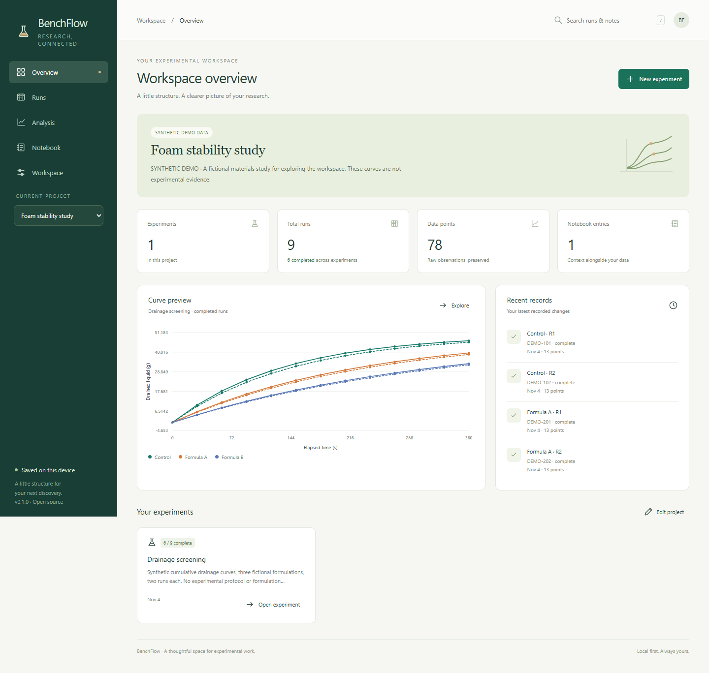

# BenchFlow

[](https://github.com/cuijialin8888-code/benchflow/actions/workflows/ci.yml)
[](LICENSE)

**A little structure for your next discovery.**

BenchFlow is a local-first experimental workspace: organize projects, track sample runs, import CSV curves, compare replicates, and keep the context in a notebook. Everything runs in your browser. No account, backend, analytics, or runtime package dependencies.

**[Open the app](https://cuijialin8888-code.github.io/benchflow/)** · [中文说明](README.zh-CN.md) · [Architecture](docs/architecture.md) · [Data & statistics](docs/data-and-statistics.md)



## One workflow, from plan to portable backup

1. **Create a project and experiment.** Define your X/Y labels and units.
2. **Plan runs.** Track sample IDs, groups, notes, and planned/running/complete status in a board or table.
3. **Bring in observations.** Preview CSV files, choose X/Y columns, and validate numeric rows before importing. Duplicate X values are rejected.
4. **Compare curves.** Select runs, overlay individual curves, or plot group means with sample-SD error bars. Inspect the contributing run count at each X.
5. **Keep the context.** Plain-text project notes stay alongside the data.
6. **Take your work with you.** Export measurements, summaries, standalone SVG charts, or a complete JSON backup.

### Built for the details that matter

- **Persistent local storage:** IndexedDB transactions keep whole-workspace saves atomic.
- **Multiple-tab protection:** revision checks reject stale saves instead of silently overwriting newer data.
- **Recoverable mistakes:** one previous saved workspace is retained, including before deletion or backup replacement.
- **Validated restoration:** versioned backups are checked for references, duplicate IDs, data types, numeric limits, and size before replacement is confirmed.
- **Data stays distinct:** duplicate a run's setup without duplicating its measurements or sample ID.
- **Portable graphics:** SVG exports include axis labels, units, experiment title, and group legend.
- **Offline shell:** after the first successful load and service-worker installation, the app can reopen offline on the same address.
- **Responsive interface:** keyboard-accessible forms and desktop/mobile layouts; `/` focuses search.

## Try it locally

Requires Node.js **22+**. No installation or build step is required:

```sh
git clone https://github.com/cuijialin8888-code/benchflow.git
cd benchflow
node server.js
```

Open **http://127.0.0.1:4173**. Choose **Explore demo** for synthetic data or **Create a project** for an empty workspace. The server binds only to the local machine, serves an allowlist of app files, and accepts no data uploads or write requests. Stop it with Ctrl+C.

Set the `PORT` environment variable if needed. Keep using the same address and port: changing either creates a separate browser storage origin. Opening `index.html` directly with `file://` is not supported.

The hosted app and the local app have **separate workspaces**. Transfer data using **Workspace → Export backup / Restore backup**.

## Data ownership

Your records are stored in this browser's IndexedDB, not in GitHub or the local server. GitHub Pages receives ordinary requests for app assets when using the hosted version; no experiment data is sent by the app. There are no external fonts, trackers, remote scripts, or cloud APIs in the application.

**Export JSON backups regularly.** Clearing browser site data, private-window closure, browser eviction, or changing origins can make local data unavailable. One-step undo is not a backup. Backups contain your complete records in plain text and are not encrypted; store them appropriately.

BenchFlow is a single-user workbench, not a regulated electronic lab notebook, secure audit trail, or multi-user collaboration service. It does not prove the authenticity or scientific validity of data.

## CSV and statistics at a glance

```csv
Time,Response
0,0
30,7.5
60,13.2
```

CSV needs a header and at least one numeric data row. Comma, semicolon, and tab delimiters are supported. Select two different columns; other columns are ignored. Decimal and scientific notation are accepted. Imported rows are sorted by X. Missing values, nonfinite numbers, duplicate numeric X, and malformed records are rejected. Each file creates or replaces **one run**. See [the sample CSV](examples/demo-curve.csv).

Statistics group selected runs by their exact group name and match **exact numeric X values**. No interpolation is performed. `n` is the count of contributing runs at that X. Sample SD uses `n − 1` and is undefined for `n = 1`. The software cannot determine whether your runs are independent; select appropriate runs and keep units consistent. Default analysis includes completed runs only.

Area is a descriptive trapezoidal integral in X-unit × Y-unit, not an application-specific performance metric. There are no automatic hypothesis tests or claims of statistical significance. Full definitions and limits: [data and statistics guide](docs/data-and-statistics.md).

## Development and verification

Core tests use only built-in Node.js modules:

```sh
node scripts/check.js
node --test test/core.test.js test/server.test.js
```

For the browser acceptance suite, install the optional, pinned test tool:

```sh
npm install --no-save --package-lock=false playwright@1.64.1
npx playwright install chromium
node test/browser.js
```

The browser suite exercises project/run creation, CSV validation, persistence, setup duplication, text escaping, chart export, JSON backup/restore, deletion/undo, concurrent tabs, mobile layout, and offline reload. It writes synthetic test artifacts to ignored `test-results/`.

CI runs core tests on Windows, Linux, and macOS with Node 22/24, and browser tests on Linux Chromium. A successful `main` build deploys only public app files to GitHub Pages. Browser UI testing does not imply all browser engines have been validated.

Build a static deployment with `node scripts/build-site.js` and host the `dist/` directory over HTTPS or localhost. No build framework or application server is needed.

## Project scope

This first release focuses on numeric X/Y curves and a dependable single-browser workflow. It does not include accounts, synchronization, XLSX parsing, instrument integrations, arbitrary table schemas, uncertainty propagation, or inferential statistical tests.

All screenshots and bundled demo measurements are **synthetic**. They are not real experimental evidence or recommended formulation/test conditions.

[MIT license](LICENSE) · [Contributing](CONTRIBUTING.md) · [Changelog](CHANGELOG.md)
