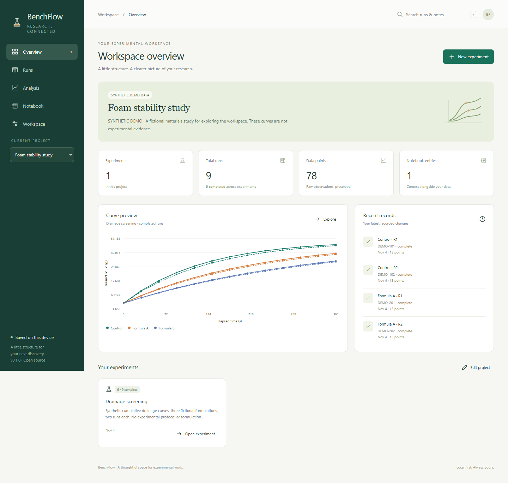

# BenchFlow · 本地实验工作台

**把实验项目、批次记录、数据曲线和实验笔记放在一起。**

**[直接打开应用](https://cuijialin8888-code.github.io/benchflow/)** · [English](README.md)

无需注册账号，数据保存在本机浏览器中。支持项目与实验管理、样本编号、实验状态看板、CSV 数据导入、曲线对比、重复实验统计、笔记及完整备份。



## 推荐操作顺序

1. 点击 **Create a project** 新建项目，或 **Explore demo** 体验合成示例。
2. 在项目中创建实验，填写 X/Y 轴名称及单位。
3. 在 **Runs** 页面创建实验记录，填写样本编号和组别，用 `planned / running / complete` 表示计划、进行中、完成。
4. 点击 **Import CSV** 导入数据，预览后选择 X 列与 Y 列。也可以在某条记录的上传按钮中替换该记录的数据。
5. 在 **Analysis** 中勾选要比较的记录，查看单条曲线或 **Mean ± SD**。
6. 在 **Notebook** 中记录观察、判断依据及异常情况。
7. 在 **Workspace** 中导出 JSON 备份，供换电脑、换浏览器或恢复工作时使用。

示例全部为合成数据，不是实验结果，也不代表推荐配方或测试条件。当前界面使用英文，项目名称、样本编号和笔记支持中文。

## 能做什么

- **管理关联记录：** 项目下有实验，实验下有多次运行或重复测量记录；每条记录可保存样本编号、组别、状态、备注和 X/Y 曲线。
- **数据导入前预览：** 支持逗号、分号、制表符分隔；自动按 X 排序；拒绝重复 X、空数值和不合法数字。
- **比较曲线：** 可选择具体实验记录；默认只统计已完成记录；支持均值和样本标准差。
- **导出结果：** 原始测量表、分组统计表、带坐标和图例的 SVG 矢量图、完整 JSON 备份。
- **防止误覆盖：** 多个标签页同时编辑时，旧页面不能直接覆盖新保存的数据。
- **恢复上次保存：** 保留前一个工作区版本，可以撤回最近一次保存或删除；只有一个历史版本，不代替备份。
- **离线使用：** 首次成功加载并安装离线缓存后，可在同一地址离线重新打开；也可完全在本机启动。

## 统计结果如何理解

**均值**是同组、同一 X 值下各条记录的平均值。**样本标准差（SD）**描述这些值的离散程度，使用 `n − 1` 分母。每个 X 点的 `n` 是实际参与计算的记录数。

仅有一条记录时，标准差未定义，界面显示 `—`，不会强行记成 0。不同记录的 X 不一致时，不做插值；各个时间点的有效重复数可能不同。

软件不知道记录是否来自真正独立的实验，也不会自动换算单位或判断显著性。分组、独立重复和单位一致性需要使用者确认。曲线面积仅采用梯形法积分，单位为 X 单位 × Y 单位，不自动解释为某种材料性能指标。

每条曲线超过 1,200 个点时，绘图会抽样显示；统计和数据导出仍保留所有点。不要用屏幕图形抽样结果寻找非常窄的瞬态峰值。

## 本机运行

需要 Node.js 22 或以上版本，无需安装应用依赖：

```sh
git clone https://github.com/cuijialin8888-code/benchflow.git
cd benchflow
node server.js
```

在浏览器打开 `http://127.0.0.1:4173`。结束时按 Ctrl+C。不要直接双击 `index.html`。

线上版本与本机版本的数据相互独立；不同浏览器、域名和端口也各有自己的工作区。请通过 **Export backup / Restore backup** 转移数据。

## 数据保存与使用限制

- 数据保存在浏览器的 IndexedDB 中，不会由应用上传到 GitHub 或本机服务端。
- 清理站点数据、关闭隐私窗口、浏览器回收存储或更换地址后，数据可能无法继续访问。请定期导出 JSON。
- JSON 备份包含完整数据和笔记，为未加密的明文文件，请自行妥善保存。
- 恢复备份会替换当前整个工作区；确认前会校验文件并显示项目、实验、记录数量。
- 每次 CSV 导入对应一条记录，最多 10 MB、10,000 个数据点；整个工作区最多 200,000 个数据点。完整备份导入上限 30 MB。
- CSV 数值使用小数点，暂不支持小数逗号、XLSX、缺失值填补或仪器直连。
- 这是单用户实验整理工具，暂不提供账户、多人协作、云同步、不可篡改审计或法规认证。

## 验证与开源

包含核心逻辑测试及真实浏览器验收，覆盖导入、持久化、备份恢复、多标签页冲突、手机布局和离线加载。跨平台核心测试在 Windows、Linux、macOS 上运行；浏览器流程在 Chromium 上验证。

采用 [MIT 许可](LICENSE)。欢迎提交可复现问题和改进建议，请勿在公开问题中上传真实敏感实验数据。
