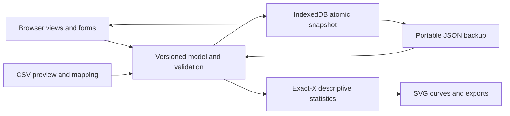

# Architecture

BenchFlow is an ES-module application with no runtime package dependencies and no backend database. The local server and GitHub Pages both serve the same static assets.

## Modules

| Module | Responsibility |
| --- | --- |
| `src/model.js` | Record factories, references, size/type validation, cascade deletion, backup parsing |
| `src/csv.js` | Quoted CSV parser, numeric column mapping, spreadsheet-safe CSV exports |
| `src/stats.js` | Welford mean/sample SD, exact-X grouping, trapezoidal area |
| `src/storage.js` | IndexedDB connection, revision checks, current/previous snapshots |
| `src/chart.js` | Escaped SVG paths, labels, error bars and legends |
| `src/app.js` | View state, forms, event delegation, downloads and user-visible errors |
| `src/demo.js` | Explicitly synthetic example workspace |
| `sw.js` | Public app-shell cache for offline reload; no record storage |
| `server.js` | Localhost-only, read-only public-file allowlist |

## Persistence and conflicts

The `benchflow` IndexedDB database contains a `workspace` object store with `current` and `previous` keys. `current` holds `{revision, data}`. A save validates a cloned candidate, starts a single read/write transaction, reads the current revision, and compares it to the editor's expected revision. If they differ, the transaction aborts. Otherwise the previous data and the next revision/data are saved together.

The UI adopts the candidate only after transaction completion. A failed transaction does not replace the in-memory or persisted workspace. A BroadcastChannel warns other tabs, but correctness relies on the transactional revision check, not message delivery.

The previous snapshot is global, not per record. Undo writes that snapshot as a new revision and makes the replaced data the next previous snapshot. Only one previous state is retained. There is no background synchronization, durable change log or authentication.

## Data relationships

Projects own experiments and notes. Experiments own runs. Runs store sample labels, a group name, status, notes and sorted X/Y points. Sample IDs are user labels, not a separate registry, and are not required to be unique. Group identity uses exact, case-sensitive names. Deleting a project or experiment explicitly removes its descendants.

The `version` field is a schema version, not an app release number. Unknown future schemas are rejected. `parseBackup` validates a complete workspace and reconstructs allowed fields; extra input metadata is dropped. Introducing a new schema requires an explicit, tested migration.

## Scope and performance

This release uses whole-workspace snapshots for straightforward atomicity and portability. Save work and memory usage scale with workspace size. CSV parsing and rendering run on the main thread. Validation caps projects, runs and points; extremely large datasets are outside the intended scope.

Chart paths use at most roughly 1,200 display samples per series plus the final point. This is a display optimization, not a lossless signal-reduction algorithm. Full data is retained for statistics and exports. Do not rely on a sampled visual trace to identify narrow transient peaks.

## Deployment

`node scripts/build-site.js` copies only app-shell assets and synthetic CSV examples into `dist/`. GitHub Actions deploys this directory only after core and browser tests pass on a push to `main`. No user workspace, test backup, local path, credential or repository metadata is included.

Relative URLs support deployment under `/benchflow/`. The service worker uses a named, versioned cache and network-first requests with cached fallback. It deliberately does not call `skipWaiting`; an updated worker normally activates after old tabs close. Advance the cache version whenever the app shell changes between releases. User records stay in IndexedDB independently of the cache.

## Security and trust

User-provided labels and note text are escaped before HTML/SVG insertion. CSV textual cells beginning with spreadsheet formula prefixes receive an apostrophe on export; JSON is the exact roundtrip format. The local server accepts only GET/HEAD and serves an explicit public path allowlist with a content security policy.

These protections are not an authorization system or encryption. Other scripts running on the same origin, browser extensions, someone with access to the browser profile, or maliciously replaced application code may access local records. Use the app only from a trusted deployment. Avoid publicly posting private backups or filenames.
